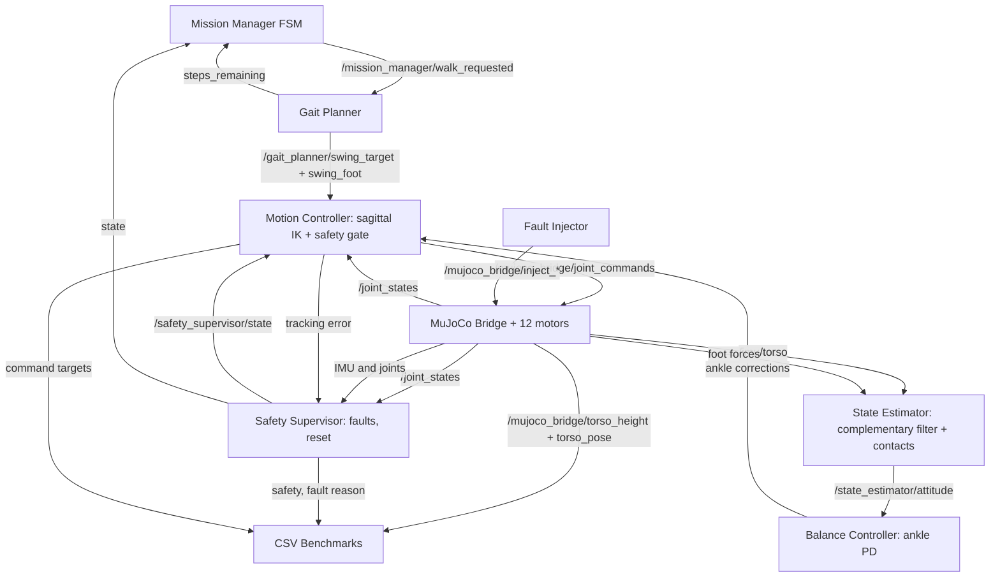

# HUMANOID-LAB architecture

## Supported-rig software graph (ROS 2 Humble)



**Important distinction:** The supported model fixes the floating torso
mechanically and is only a subsystem-integration test rig. The free-base
model is available via `model_file:=humanoid_biped.xml` but stable dynamic
walking has not been achieved or verified in this revision.

## Coordinate conventions

- World +x forward; +z up; hip spacing 0.20 m.
- Hip height 0.58 m; ankle to sole offset 0.03 m.
- Thigh and shank are each 0.30 m.
- The IK maps *world-fixed* foot targets to joint angles using a *fixed*
  nominal pelvis position. No floating-base state is applied in IK.
- Left/right sagittal pitch signs match axes `(0,-1,0)` in MJCF.
- Lateral moves beyond 25 mm are explicitly rejected (needs 3D IK).

## Safety and liveness

The joint controller receives **one owner** of actuator commands. Joint
feedback timeout (350ms default) or FAULT/SAFE_HOLD/RECOVERY triggers a
measured-pose hold. The MuJoCo bridge independently holds measured joints
if motor commands go stale (300ms), so a dead publisher cannot indefinitely
replay a moving gait. A gated reset service rejects reset while IMU/joint
feedback is stale or tracking error high:

```bash
ros2 service call /safety_supervisor/reset std_srvs/srv/Trigger '{}'
```

The safety gate is a software demo; it does **not** guarantee physical safety
for a free-falling robot or actual hardware.

## ros2_control status

The active backend uses a custom `rclpy` MuJoCo bridge. The example
`humanoid_hardware/config/controllers.yaml` documents a future
`ros2_control` integration, but `controller_manager` and
`mujoco_ros2_control` do not run in current launch files. Do not describe
this project as an operational `ros2_control` hardware interface.
